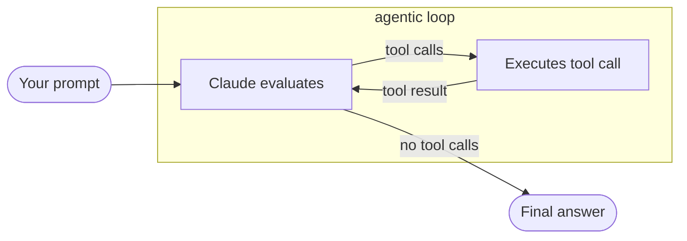
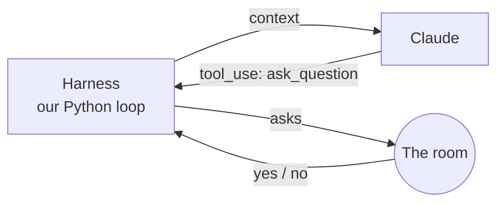
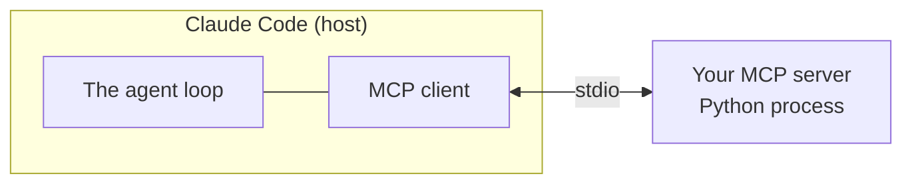

# My agent yada, yada, yada

<p class="text-2xl opacity-70">who owns the loop, though?</p>

---

# A few definitions first

<div class="text-lg">

| Term | Definition |
| --- | --- |
| **Tool** | A function plus a description the model reads: a name, a description and an input schema |
| **Context** | Everything the model sees on a call: system prompt, tool definitions, messages. The model has no memory, so the harness resends all of it every time |
| **Harness** | The code around the model that provides the tools, manages context and runs the loop |
| **Agentic loop** | The model responds, the harness runs the requested tools, results go back into context, repeat until there are no tool calls |

</div>

---

# The agentic loop

<div class="text-lg mt-2">

The model **evaluates**, **calls tools**, gets the **results** back, and repeats until it responds without a tool call.

</div>



<v-click>

<div class="mt-6 text-xl text-center">

Keep this loop in mind while we play a game.

</div>

</v-click>

<div class="absolute bottom-4 left-14 text-xs opacity-60">

Source: code.claude.com/docs/en/agent-sdk/agent-loop

</div>

---

# What just happened?

<v-clicks>

- Couldn't we have just opened claude.ai and asked it to play?
- Did you just build a wrapper around Claude?

</v-clicks>

<v-click>

<div class="mt-8 text-xl">

**Not exactly.** We ran an **agentic loop** that called a **tool** — one we defined in code.

</div>

</v-click>

<v-click>



<div class="text-center opacity-80">

The answer goes into context as a `tool_result`, then back to step 1. Repeat until Claude answers without a tool call.

</div>

</v-click>

<!--
Claude decided what to ask. Our code decided what "asking" means: print it, wait for the room.
claude.ai could play the game, but it couldn't call our ask_question tool, enforce the question limit, or run inside our code.
-->
---

# A tool

<div class="text-xl">

**Tool:** a capability you describe to the model. **The code** runs it, not Claude.

</div>

<v-click>

```python
    {
        "name": "ask_question",
        "description": (
            "Ask a yes-or-no question that helps you deduce the secret identity "
            "of a person, place, or thing. The room answers with exactly one of: "
            f"'yes' or 'no'. You get {MAX_QUESTIONS} questions."
        ),
        "input_schema": {
            "type": "object",
            "properties": {
                "question": {
                    "type": "string",
                    "description": "A yes-or-no question, e.g. Is it alive?",
                }
            },
            "required": ["question"],
        },
    }
```

</v-click>

<v-click>

The description works like a prompt. It's all Claude has to decide when and how to use the tool, so writing it well matters.

</v-click>

---

# The harness

<div class="text-xl">

**Agentic loop / harness:** the code that runs the loop.

</div>

```python {*|1-8|10-14|16-18|20-33|35-48|*}{maxHeight:'340px'}
def play_game():
    messages = [
        {
            "role": "user",
            "content": "The room has chosen. Ask your first question.",
        }
    ]
    questions_asked = 0

    while questions_asked < MAX_QUESTIONS:
        response = send_message(
            model=MODEL, messages=messages, tools=tools, system=SYSTEM_PROMPT
        )
        messages.append({"role": "assistant", "content": response.content})

        if response.stop_reason != "tool_use":
            print("Stopped because:", response.stop_reason)
            return

        tool_results = []
        for block in response.content:
            if block.type != "tool_use":
                continue
            if questions_asked >= MAX_QUESTIONS:
                answer = "You are out of questions."
            else:
                questions_asked += 1
                print(f"[Question {questions_asked}/{MAX_QUESTIONS}]")
                answer = get_answer(block.input["question"])
            tool_results.append(
                {"type": "tool_result", "tool_use_id": block.id, "content": answer}
            )
        messages.append({"role": "user", "content": tool_results})

    messages[-1]["content"].append(
        {
            "type": "text",
            "text": f"You have used all {MAX_QUESTIONS} questions. Make your final guess.",
        }
    )
    response = send_message(
        model=MODEL,
        messages=messages,
        tools=tools,
        system=SYSTEM_PROMPT,
        tool_choice={"type": "none"},
    )
    print_block_text(response)
```

<v-click>

That's `twenty_questions_harness.py`: about 100 lines. Not a wrapper around Claude, but **the loop that lets Claude act**.

</v-click>

<!--
Click through:
1. Start the conversation and the question counter.
2. Send the whole conversation to Claude; remember its reply.
3. No tool call? Claude is done.
4. Run each tool call (ask the room) and send back tool_results matched by tool_use_id.
5. Out of questions: tool_choice none forces a final text guess.
Scroll the code block if the highlighted lines are below the fold.
-->

---

# The conversation grows every turn

<div grid="~ cols-[3fr_1fr] gap-6" class="mt-2 text-sm">
<div>

```python {1|2-3|4|5-6|7|8-9|10}{lines:false}
messages = [
  {"role": "user",      "content": "The room has chosen. Ask your first question."},
  {"role": "assistant", "content": [tool_use("Is it a living thing?", id="toolu_012okB…")]},
  {"role": "user",      "content": [tool_result("yes", tool_use_id="toolu_012okB…")]},
  {"role": "assistant", "content": [tool_use("Is it a person?", id="toolu_01Xq…")]},
  {"role": "user",      "content": [tool_result("yes", tool_use_id="toolu_01Xq…")]},
  {"role": "assistant", "content": [tool_use("Is it a real person?", id="toolu_01Rk…")]},
  {"role": "user",      "content": [tool_result("no", tool_use_id="toolu_01Rk…")]},
  # ...one tool_use + one tool_result per question
]
```

</div>
<div>

| Call | Input tokens |
| --- | --- |
| 1 | 536 |
| 2 | 606 |
| 3 | 666 |
| 10 | 1,132 |

<div class="text-xs opacity-60 mt-2">

From a real run: 9 questions to Hermione Granger, $0.046 total.

</div>

</div>
</div>

<v-click>

Every call sends the **whole list**. Each `tool_use` is answered by a `tool_result` with the **same id**.

</v-click>

---

# Why it grows

<div class="text-lg space-y-4 mt-4">

<div v-click>

**The API is stateless.** Each call starts from zero; Claude only knows what's in `messages`.

</div>

<div v-click>

**Claude needs the history to play.** Question 5 only makes sense if it remembers answers 1 to 4.

</div>

<div v-click>

**The cost:** every turn resends everything, so cost and latency climb, and long sessions eventually fill the context window.

</div>

</div>

<v-click>

<div class="mt-6 text-xl">

That's why the loop has **two** `messages.append` calls: one for Claude's turn, one for the tool results.

</div>

</v-click>

---

# Why use tools and agents?

<div class="text-xl mt-6 space-y-6">

<div v-click>

A model on its own is essentially **text in, text out**. It can't hear the room's answer, look up this year's papers, or put a meeting on your calendar. Everything it knows is in its training or in the text you send it.

</div>

<div v-click>

**Tools** let the model reach beyond the text you send it: people, APIs, files, your systems.

</div>

<div v-click>

**The code stays in charge:** it decides what a tool does, and it sets the limits.

</div>

</div>

<!--
claude.ai could "play" 20 questions, but only by talking with one person in a chat box. It can't reach the room, or anything else outside the conversation.
-->

---
layout: section
---

# From harness to MCP server

---

# Most of the harness is plumbing

<div grid="~ cols-2 gap-8" class="mt-6">
<div v-click>

### Specific to 20 questions

- the `ask_question` schema
- `get_answer()` and `input()`
- `VALID_ANSWERS`
- `MAX_QUESTIONS`

</div>
<div v-click>

### Plumbing

- `send_message()`
- the `while` loop
- `messages.append(...)`
- the `stop_reason` check
- matching `tool_use_id`
- `tool_choice: none`

</div>
</div>

<v-click>

<div class="mt-8 text-xl">

Every agent needs the same plumbing. **Claude Code already is a harness.**
What if it ran the loop, and we only supplied the tool?

</div>

</v-click>

---

# MCP oversimplified

<div class="text-xl">

**MCP (Model Context Protocol):** a standard way to package tools so any MCP client can use them.

</div>



<v-clicks>

- **Host:** the app you work in. It runs the loop.
- **Server:** the code you write. It offers tools.
- **stdio:** Claude Code starts your server and talks to it over stdin and stdout.

</v-clicks>

---

# `MCPServer`: the piece that matters

<div grid="~ cols-2 gap-6" class="mt-2">
<div>

```python {1|3-7|4|5-6|7|9-10}{lines:false}
mcp = MCPServer("twenty-questions")

@mcp.tool()
def ask_question(question: str) -> str:
    """Ask a yes-or-no question that helps
    you deduce the secret identity..."""
    return answer

def main():
    mcp.run()
```

</div>
<div class="text-sm">

- `MCPServer("...")` creates the server. Clients show it by name.
- `@mcp.tool()` turns a function into a tool.
- **Type hints become the input schema.** `question: str` is the JSON Schema.
- **The docstring becomes the description,** the text Claude reads.
- **The return value becomes the tool result.**
- `mcp.run()` starts the server.

</div>
</div>

<!--
Each click highlights the line that matches the next bullet.
The real twenty-questions server passes description= instead of a docstring; same result.
Never print() to stdout in a stdio server: stdout is the protocol pipe. Use stderr.
-->

---

# How the server works

<div grid="~ cols-2 gap-6" class="mt-2">
<div>

```python {all|6-10|15|8|1-4|9|11-13}{lines:false}
def ask_the_room(question: str) -> Elicit[Answer]:
    if questions_asked >= MAX_QUESTIONS:
        raise ToolError("Out of questions. Guess.")
    return Elicit(message=question, schema=Answer)

@mcp.tool(description="Ask a yes-or-no question...")
def ask_question(
    question: str,
    room: Annotated[Answer, Resolve(ask_the_room)],
) -> str:
    global questions_asked
    questions_asked += 1
    return room.answer

mcp.run()
```

</div>
<div class="text-sm">

**Phase 1: Startup** (once)

<div v-click="1">The decorator <b>reads the signature</b>: schema from <code>question: str</code>, resolver from <code>Resolve(ask_the_room)</code>. Nothing is called yet.</div>

<div v-click="2" class="mt-2"><code>mcp.run()</code> waits. From here, the SDK calls the code.</div>

**Phase 2: Each tool call**

<div v-click="3">Claude sends <code>ask_question(question="Is it alive?")</code>.</div>

<div v-click="4" class="mt-2">The SDK runs <code>ask_the_room</code>. It returns an <code>Elicit</code>.</div>

<div v-click="5" class="mt-2">Claude Code shows the form. The room answers <code>"yes"</code>.</div>

<div v-click="6" class="mt-2">Only now does the <b>body</b> run: count the question, return <code>"yes"</code>.</div>

</div>
</div>

<!--
The confusing part: code runs where you can't see it. It runs in the SDK, which reads your function signature and acts on it.
The limit check sits in the resolver so it runs before the room is asked. The counter sits in the body because the body runs exactly once per call.
-->

---

# What the SDK does for you

```python
# Phase 1, startup: the decorator does this
TOOLS["ask_question"] = {
    "function": ask_question,
    "schema": {"question": "string"},       # from `question: str`
    "resolvers": {"room": ask_the_room},    # from `Resolve(ask_the_room)`
}

# Phase 2, when Claude calls the tool
def handle_tool_call(name, args):           # args = {"question": "Is it alive?"}
    tool = TOOLS[name]
    request = tool["resolvers"]["room"](question=args["question"])   # ask_the_room
    reply = ask_user_through_client(request)                          # the form
    return tool["function"](question=args["question"], room=reply)   # the body
```

<v-click>

<div class="mt-4 text-lg">

Your function signature is **instructions for the SDK**. It reads them at startup, then follows them each time Claude calls the tool.

</div>

</v-click>

<v-click>

<div class="mt-2 opacity-80">

The MCP server is **declarative**: you describe what you need, and the SDK decides when to run it.

</div>

</v-click>

<!--
This is pseudo-code, not the real SDK. Everything that feels hidden lives in handle_tool_call.
-->

---

# My hopes for you

<div class="text-2xl space-y-8 mt-10">

<div v-click>

That you **build cool tools** that make life a little easier.

</div>

<div v-click>

That it **sparks research ideas:** AI governance, oversight, multi-agent systems.

</div>

<div v-click>

Or, at the very least, I hope you feel **more in the loop**.

</div>

</div>

---
layout: center
class: text-center
---

# Thank you!
