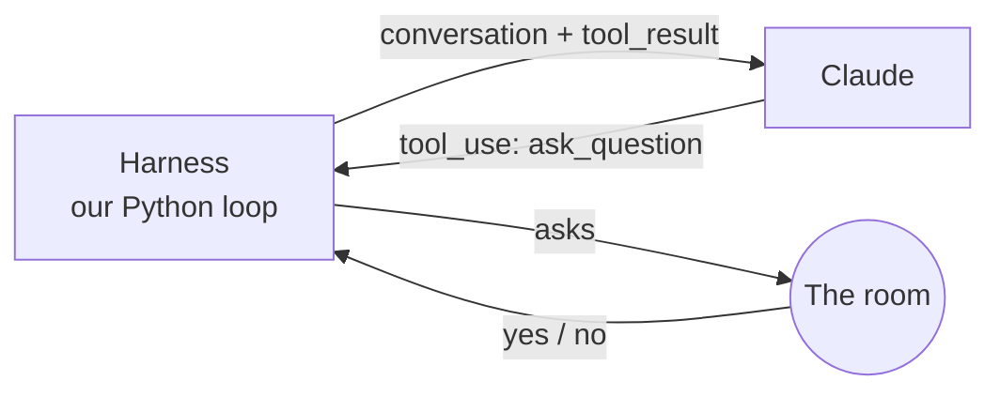
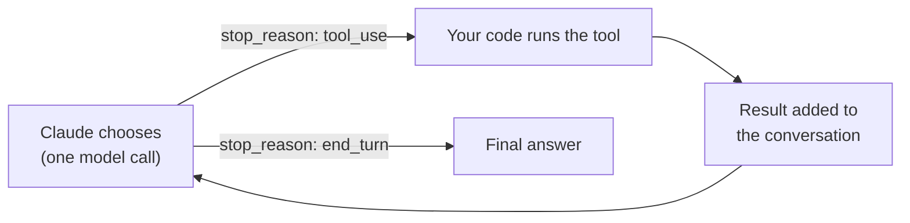
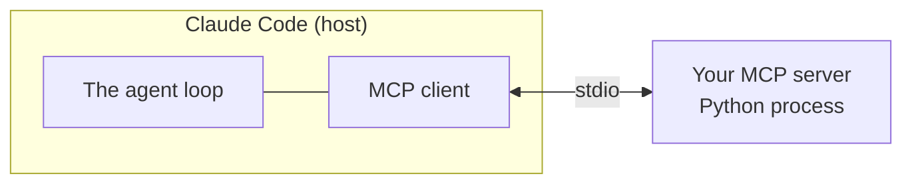

# My agent yada, yada, yada

<p class="text-2xl opacity-70">who owns the loop, though?</p>

<div class="mt-10 text-lg opacity-80">
  <div v-click class="font-bold mb-2">Other titles I considered</div>
  <div v-click>My agent is everywhere, you're never there</div>
  <div v-click>Are you down with MCP? Yeah, you know me</div>
  <div v-click>Loop, there it is</div>
</div>

---
layout: center
class: text-center
---

# a game of 20 questions with AI?

---

# What just happened?

<v-clicks>

- Couldn't we have just opened claude.ai and asked it to play?
- Did you just build a wrapper around Claude?

</v-clicks>

<v-click>

<div class="mt-8 text-xl">

**Not exactly.** We ran an **agentic loop** that called a **tool** — one we defined in code.

</div>

</v-click>

<v-click>



</v-click>

<!--
Claude decided what to ask. Our code decided what "asking" means: print it, wait for the room.
claude.ai could play the game, but it couldn't call our ask_question tool, enforce the question limit, or run inside our code.
-->

---

# Outline

<v-clicks>

1. **Why use tools and agents?**
2. **From harness to MCP server**

</v-clicks>

---
layout: section
---

# Why use tools and agents?

---

# A model, on its own

<div class="text-2xl mt-6">

**Model:** text in, text out.

</div>

<v-click>

It can't act on the world by itself. It can't:

</v-click>

<v-clicks>

- hear the room's answer
- look up papers published this year
- put a meeting on your calendar

</v-clicks>

<v-click>

<div class="mt-8 text-xl">

Everything it knows is in its training or in the text you send it.

</div>

</v-click>

<!--
claude.ai could "play" 20 questions, but only by talking with one person in a chat box. It can't reach the room, or anything else outside the conversation.
-->

---

# A tool

<div class="text-xl">

**Tool:** a capability you describe to the model. **Your code** runs it, not Claude.

</div>

<v-click>

```python
    {
        "name": "ask_question",
        "description": (
            "Ask a yes-or-no question that helps you deduce the secret identity "
            "of a person, place, or thing. The room answers with exactly one of: "
            f"'yes' or 'no'. You get {MAX_QUESTIONS} questions."
        ),
        "input_schema": {
            "type": "object",
            "properties": {
                "question": {
                    "type": "string",
                    "description": "A yes-or-no question, e.g. Is it alive?",
                }
            },
            "required": ["question"],
        },
    }
```

</v-click>

<v-click>

A name, a description, an input schema. **No implementation.** Claude only sees the description.

</v-click>

---

# An agent

<div class="text-xl">

**Agent:** a model running in a loop. Claude chooses, your code acts, and the conversation grows, until Claude decides it's done.

</div>

<v-click>



</v-click>

<v-click>

Every response includes a **`stop_reason`**. It tells your code what Claude chose: `tool_use` means "run my tool," `end_turn` means "I'm done."

</v-click>

<v-click>

In 20 questions, **every question depends on the answers before it**, so Claude has to choose them one at a time.

</v-click>

<!--
"Claude chooses" is one send_message() call. Claude reads the whole conversation and either picks the next question (tool_use) or announces its guess (end_turn).
Claude only requests the tool; the harness runs it.
-->

---

# The harness

<div class="text-xl">

**Agentic loop / harness:** the code that runs the loop.

</div>

```python {*|1-8|10-14|16-18|20-33|35-48|*}{maxHeight:'340px'}
def play_game():
    messages = [
        {
            "role": "user",
            "content": "The room has chosen. Ask your first question.",
        }
    ]
    questions_asked = 0

    while questions_asked < MAX_QUESTIONS:
        response = send_message(
            model=MODEL, messages=messages, tools=tools, system=SYSTEM_PROMPT
        )
        messages.append({"role": "assistant", "content": response.content})

        if response.stop_reason != "tool_use":
            print("Stopped because:", response.stop_reason)
            return

        tool_results = []
        for block in response.content:
            if block.type != "tool_use":
                continue
            if questions_asked >= MAX_QUESTIONS:
                answer = "You are out of questions."
            else:
                questions_asked += 1
                print(f"[Question {questions_asked}/{MAX_QUESTIONS}]")
                answer = get_answer(block.input["question"])
            tool_results.append(
                {"type": "tool_result", "tool_use_id": block.id, "content": answer}
            )
        messages.append({"role": "user", "content": tool_results})

    messages[-1]["content"].append(
        {
            "type": "text",
            "text": f"You have used all {MAX_QUESTIONS} questions. Make your final guess.",
        }
    )
    response = send_message(
        model=MODEL,
        messages=messages,
        tools=tools,
        system=SYSTEM_PROMPT,
        tool_choice={"type": "none"},
    )
    print_block_text(response)
```

<v-click>

That's `twenty_questions_harness.py`: about 100 lines. Not a wrapper around Claude, but **the loop that lets Claude act**.

</v-click>

<!--
Click through:
1. Start the conversation and the question counter.
2. Send the whole conversation to Claude; remember its reply.
3. No tool call? Claude is done.
4. Run each tool call (ask the room) and send back tool_results matched by tool_use_id.
5. Out of questions: tool_choice none forces a final text guess.
Scroll the code block if the highlighted lines are below the fold.
-->

---

# The conversation grows every turn

<div grid="~ cols-[3fr_1fr] gap-6" class="mt-2 text-sm">
<div>

```python {1|2-3|4|5-6|7|8-9|10}{lines:false}
messages = [
  {"role": "user",      "content": "The room has chosen. Ask your first question."},
  {"role": "assistant", "content": [tool_use("Is it a living thing?", id="toolu_012okB…")]},
  {"role": "user",      "content": [tool_result("yes", tool_use_id="toolu_012okB…")]},
  {"role": "assistant", "content": [tool_use("Is it a person?", id="toolu_01Xq…")]},
  {"role": "user",      "content": [tool_result("yes", tool_use_id="toolu_01Xq…")]},
  {"role": "assistant", "content": [tool_use("Is it a real person?", id="toolu_01Rk…")]},
  {"role": "user",      "content": [tool_result("no", tool_use_id="toolu_01Rk…")]},
  # ...one tool_use + one tool_result per question
]
```

</div>
<div>

| Call | Input tokens |
| --- | --- |
| 1 | 536 |
| 2 | ~670 |
| 3 | ~800 |
| 10 | ~1,700 |
| 20 | ~3,000 |

<div class="text-xs opacity-60 mt-2">

Call 1 is measured; the rest are estimates.

</div>

</div>
</div>

<v-click>

Every call sends the **whole list**. Each `tool_use` is answered by a `tool_result` with the **same id**.

</v-click>

---

# Why it grows

<v-clicks>

- **The API is stateless.** Each call starts from zero; Claude only knows what's in `messages`.
- **Claude needs the history to play.** Question 5 only makes sense if it remembers answers 1 to 4.
- **Every `tool_use` must be answered.** The next message carries a `tool_result` with the same `tool_use_id`.
- **The cost:** every turn resends everything, so cost and latency climb, and long sessions eventually fill the context window.

</v-clicks>

<v-click>

<div class="mt-6 text-xl">

That's why the loop has **two** `messages.append` calls: one for Claude's turn, one for the tool results.

</div>

</v-click>

---

# So why use tools and agents?

<v-clicks>

- **Tools** let the model reach beyond the text you send it: people, APIs, files, your systems.
- **Agents** handle tasks where the next step depends on the last result.
- **Your code stays in charge:** it decides what a tool does, and it sets the limits.

</v-clicks>

---

# The core six

| Term | One line |
| --- | --- |
| Model | Text in, text out |
| Tool | A capability you describe; your code runs it |
| Tool call | Claude's request to run a tool |
| Tool result | Your code's answer, matched by `tool_use_id` |
| Agent | A model in a loop with tools |
| Harness | The code that runs the loop |

---
layout: section
---

# From harness to MCP server

---

# Most of the harness is plumbing

<div grid="~ cols-2 gap-8" class="mt-6">
<div v-click>

### About 20 questions

- the `ask_question` schema
- `get_answer()` and `input()`
- `VALID_ANSWERS`
- `MAX_QUESTIONS`

</div>
<div v-click>

### Plumbing

- `send_message()`
- the `while` loop
- `messages.append(...)`
- the `stop_reason` check
- matching `tool_use_id`
- `tool_choice: none`

</div>
</div>

<v-click>

<div class="mt-8 text-xl">

Every agent needs the same plumbing. **Claude Code already is a harness.**
What if it ran the loop, and we only supplied the tool?

</div>

</v-click>

---

# MCP in one slide

<div class="text-xl">

**MCP (Model Context Protocol):** a standard way to package tools so any MCP client can use them.

</div>



<v-clicks>

- **Host:** the app you work in. It runs the loop.
- **Server:** your code. It offers tools.
- **stdio:** Claude Code starts your server and talks to it over stdin and stdout.

</v-clicks>

---

# `MCPServer`: the piece that matters

<div grid="~ cols-2 gap-6" class="mt-2">
<div>

```python {1|3-7|4|5-6|7|9-10}{lines:false}
mcp = MCPServer("twenty-questions")

@mcp.tool()
def ask_question(question: str) -> str:
    """Ask a yes-or-no question that helps
    you deduce the secret identity..."""
    return answer

def main():
    mcp.run()
```

</div>
<div class="text-sm">

- `MCPServer("...")` creates the server. Clients show it by name.
- `@mcp.tool()` turns a function into a tool.
- **Type hints become the input schema.** `question: str` is the JSON Schema you wrote by hand.
- **The docstring becomes the description,** the text Claude reads.
- **The return value becomes the tool result.**
- `mcp.run()` handles the protocol over stdio.

</div>
</div>

<!--
Each click highlights the line that matches the next bullet.
The real twenty-questions server passes description= instead of a docstring; same result.
Never print() to stdout in a stdio server: stdout is the protocol pipe. Use stderr.
-->

---

# The harness, translated

<div class="text-sm">

| Harness | Server |
| --- | --- |
| `tools = [{... "input_schema" ...}]` | `def ask_question(question: str)` + docstring |
| `while` loop, `messages`, `stop_reason` | *gone*: Claude Code runs the loop |
| `MAX_QUESTIONS` + `tool_choice: none` | `ToolError`: enforces the limit, *asks* for a guess |
| `SYSTEM_PROMPT`, `MODEL` | *gone*: the client chooses |
| `get_answer()` with `input()` | `Elicit` (game-specific, next slide) |

</div>

<v-click>

<div class="mt-4 text-lg">

Less code, **less control.** The harness *guaranteed* a final guess; the server only *asks* for one.

</div>

</v-click>

---

# Game-specific: `Elicit` and `Resolve`

This game needs one thing most tools don't: **an answer from a person.**

<v-clicks>

- A stdio server can't call `input()`; stdin is the protocol pipe.
- **`Elicit`** is a request: "ask the user this, and expect yes or no." Claude Code shows the form.
- **`Resolve`** fills `room` with the room's answer before the body runs. Claude never sees `room`.

</v-clicks>

<v-click>

```python
def ask_question(
    question: str,                                    # from Claude
    room: Annotated[Answer, Resolve(ask_the_room)],  # from the room
) -> str:
    return room.answer
```

</v-click>

<v-click>

<div class="mt-4 text-lg">

The next two servers call APIs, not people. **They don't need either.**

</div>

</v-click>

---

# What the SDK does for you

<div grid="~ cols-2 gap-8" class="mt-2 text-sm">
<div v-click>

### Startup: once

1. Imports and constants load.
2. `@mcp.tool` **reads the signature**:
   - `question: str` → the schema Claude sees
   - `room` + `Resolve` → "fill this in with `ask_the_room`"
3. `mcp.run()` waits. Nothing is called yet.

</div>
<div v-click>

### Each tool call

4. Claude sends `ask_question(question="Is it alive?")`.
5. The SDK calls `ask_the_room(question=...)`, matched **by name**.
6. Claude Code shows the form; the room answers.
7. The SDK calls `ask_question(question, room)`. **The body runs.**

</div>
</div>

<v-click>

<div class="mt-6 text-lg">

Your signature is **instructions for the SDK**. The harness was imperative: you wrote every step. The server is declarative: you describe what you need.

</div>

</v-click>

<!--
Nothing runs "inside" the def. The SDK reads it at startup and does the wiring in its own code each time Claude calls the tool.
Rename ask_the_room's parameter to q and the server fails at startup with InvalidSignature: the names are checked before any game starts.
-->

---

# Register it once

```bash
claude mcp add --scope project twenty-questions -- uv run twenty-questions-server
```

```json
// .mcp.json: checked in, shared with anyone who clones the repo
"twenty-questions": {
  "type": "stdio",
  "command": "uv",
  "args": ["run", "twenty-questions-server"]
}
```

<v-click>

Then, in Claude Code: *"Let's play 20 questions using the ask_question tool."*

</v-click>

---

# The same pattern, every server

Every server: `MCPServer(...)` → `@mcp.tool()` with typed arguments → `mcp.run()`

<div class="text-sm mt-4">

| | `twenty-questions` | `openalex` | `reading-list` |
| --- | --- | --- | --- |
| Tool | `ask_question` | `search_papers` | `add_paper` |
| Description from | `description=` | docstring | docstring |
| `ToolError` | ✓ | | ✓ |
| Talks to | **a person** (`Elicit`) | **an API** | **an API** |

</div>

<v-click>

<div class="mt-4 text-lg">

Learn `MCPServer` once. The rest is ordinary Python.

</div>

</v-click>
